# CS 422 HW2 Report

Repository: [CS422-Networks-Group/HW2](https://github.com/CS422-Networks-Group/HW2). Code links below point to commit [`54b78a9`](https://github.com/CS422-Networks-Group/HW2/tree/54b78a96180478b7f7a17f0a46f5614d0260b5d9), which produced the Part 1 and Part 2 results.

## Setup and reproduction

- Entry point: [`src/main.py`](https://github.com/CS422-Networks-Group/HW2/blob/54b78a96180478b7f7a17f0a46f5614d0260b5d9/src/main.py). All command-line options are documented in the [README](../README.md).
- Server list: [`data/listed_iperf3_servers.csv`](../data/listed_iperf3_servers.csv), taken from [iperf3serverlist.net](https://iperf3serverlist.net/).
- Dependencies: Python 3, `pandas==3.0.6`, `matplotlib==3.11.2` ([requirements.txt](../requirements.txt)).
- Host kernel: `6.6.87.2-microsoft-standard-WSL2` (Windows, WSL2). The script records this in `run_metadata.json`.
- Raw output: [`results/`](../results/) (`tcp_stats.csv`, `goodput.csv`, `summary.csv`, `run_metadata.json`, and the PDF plots).

The Part 1 and 2 results came from this command (session `20261018T201911`):

```
python3 -m venv .venv
.venv/bin/pip install -r requirements.txt
.venv/bin/python src/main.py data/listed_iperf3_servers.csv --n 10 --time 60 --interval 1.0 --out results
```

### Docker

The [`Dockerfile`](../Dockerfile) is based on `ubuntu:24.04` and runs `src/main.py`, so running the container with no arguments runs the whole pipeline (CUBIC, Reno, and BBR tests, CSVs, summary tables, and plots). Since the container uses the host kernel, the host has to load BBR and allow unprivileged sockets to pick each algorithm first:

```
sudo modprobe tcp_bbr
sudo sysctl -w net.ipv4.tcp_allowed_congestion_control="reno cubic bbr"
```

Then, from the repo root:

```
docker build -t hw2 .
docker run --rm --network host -v "$PWD/results:/hw2/results" hw2
```

Arguments after the image name are passed to `main.py`.

## Part 1: iPerf throughput application

### (a) iperf3-compatible client

The client talks to the iperf3 server over plain sockets and never calls the `iperf3` binary. One test is handled by [`run_test()`](https://github.com/CS422-Networks-Group/HW2/blob/54b78a96180478b7f7a17f0a46f5614d0260b5d9/src/main.py#L98-L180):

1. **Control connection** ([L99–L112](https://github.com/CS422-Networks-Group/HW2/blob/54b78a96180478b7f7a17f0a46f5614d0260b5d9/src/main.py#L99-L112)): connect over TCP and send a random 36-character cookie followed by a null byte.
2. **Parameter exchange** ([L114–L121](https://github.com/CS422-Networks-Group/HW2/blob/54b78a96180478b7f7a17f0a46f5614d0260b5d9/src/main.py#L114-L121)): wait for `PARAM_EXCHANGE`, then send a 4-byte length and the JSON test parameters.
3. **Data connection** ([L123–L132](https://github.com/CS422-Networks-Group/HW2/blob/54b78a96180478b7f7a17f0a46f5614d0260b5d9/src/main.py#L123-L132)): on `CREATE_STREAMS`, open a second TCP connection and send the same cookie.
4. **Transmission** ([L134–L149](https://github.com/CS422-Networks-Group/HW2/blob/54b78a96180478b7f7a17f0a46f5614d0260b5d9/src/main.py#L134-L149)): after `TEST_START` and `TEST_RUNNING`, send 128 KiB blocks until `--time` seconds have passed.
5. **Termination** ([L151–L180](https://github.com/CS422-Networks-Group/HW2/blob/54b78a96180478b7f7a17f0a46f5614d0260b5d9/src/main.py#L151-L180)): send `TEST_END`, exchange JSON results, read `DISPLAY_RESULTS`, send `IPERF_DONE`, and close both sockets.

Every failure raises an exception that [`main()`](https://github.com/CS422-Networks-Group/HW2/blob/54b78a96180478b7f7a17f0a46f5614d0260b5d9/src/main.py#L274-L302) logs before moving on to the next server. A busy or overloaded server replies with `ACCESS_DENIED` instead of `PARAM_EXCHANGE`, and a server that rejects the parameters replies with something other than `CREATE_STREAMS`; both fail the state check. Both sockets have a 10 s timeout, so a server that never answers raises `socket.timeout` (66.35.20.123:30001 failed this way in our run). If the server closes the connection early, the next read comes back empty or raises `ConnectionResetError`.

### (b) Destination selection

`main()` shuffles the server list and tries servers in that order until `--n` tests succeed or `--max-attempts` (default 30) servers have been tried. Each attempt is logged in `run_metadata.json` with its address, port, and outcome, and a shortfall prints `shortfall: only k of n servers succeeded`. Our run asked for 10 servers and got 10 after 11 attempts, so there was no shortfall.

### (c) Goodput

Goodput is computed in [`tcp_sample()`](https://github.com/CS422-Networks-Group/HW2/blob/54b78a96180478b7f7a17f0a46f5614d0260b5d9/src/main.py#L38-L45) from the kernel's cumulative `tcpi_bytes_acked` on the data socket, divided by the actual time between reads:

```math
\text{goodput}_k = \frac{(\text{bytes\_acked}_k - \text{bytes\_acked}_{k-1}) \cdot 8}{t_k - t_{k-1}}
```

The plot ([`results/goodput.pdf`](../results/goodput.pdf)) is generated in [`main()` L325–L336](https://github.com/CS422-Networks-Group/HW2/blob/54b78a96180478b7f7a17f0a46f5614d0260b5d9/src/main.py#L325-L336).

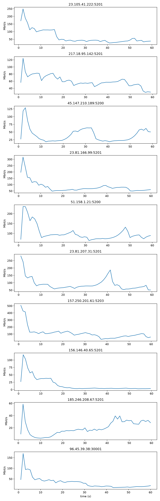

*Goodput over 60 s for each destination (CUBIC, 1 s samples).*

Summary in Mbit/s ([`results/summary.csv`](../results/summary.csv)):

| Destination | Algorithm | Min | Median | Mean | p95 |
| --- | --- | --- | --- | --- | --- |
| 157.250.201.61:5203 | cubic | 24.7 | 104.3 | 112.4 | 253.3 |
| 51.158.1.21:5200 | cubic | 63.8 | 89.6 | 100.4 | 186.7 |
| 23.81.207.31:5201 | cubic | 51.1 | 78.0 | 90.5 | 166.7 |
| 23.81.166.99:5201 | cubic | 48.4 | 68.7 | 82.9 | 162.0 |
| 23.105.41.222:5201 | cubic | 25.4 | 42.7 | 65.3 | 159.9 |
| 217.18.95.142:5201 | cubic | 28.5 | 57.0 | 60.4 | 82.2 |
| 45.147.210.189:5200 | cubic | 18.5 | 29.1 | 39.9 | 67.1 |
| 96.45.39.38:30001 | cubic | 9.2 | 29.4 | 32.5 | 93.1 |
| 185.246.208.67:5201 | cubic | 3.1 | 17.1 | 19.9 | 35.6 |
| 156.146.40.65:5201 | cubic | 2.9 | 4.6 | 17.7 | 64.5 |

## Part 2: TCP stats tracing

All Part 2 runs used `cubic`, the kernel default. We read the algorithm back from the data socket with `getsockopt(TCP_CONGESTION)` and store it in the `algorithm` column of every row.

### (a) Extracting TCP socket statistics

The client reads `TCP_INFO` from the data socket once before sending, then after each `sendall()` once at least `--interval` (1 s) has passed ([L140–L149](https://github.com/CS422-Networks-Group/HW2/blob/54b78a96180478b7f7a17f0a46f5614d0260b5d9/src/main.py#L140-L149)). Goodput and the TCP stats come from the same read, so they share a timestamp.

**Decoding format.** [`tcp_info()`](https://github.com/CS422-Networks-Group/HW2/blob/54b78a96180478b7f7a17f0a46f5614d0260b5d9/src/main.py#L30-L35) unpacks the buffer as Linux `struct tcp_info` (from `include/uapi/linux/tcp.h`) up to `tcpi_snd_wnd`, which is 232 bytes on kernel 5.4 and newer. The format string and field names are at [L12–L27](https://github.com/CS422-Networks-Group/HW2/blob/54b78a96180478b7f7a17f0a46f5614d0260b5d9/src/main.py#L12-L27):

```
TCP_INFO_FMT = "=8B24I4Q6IQ3Q2I2Q2I2I"   # 232 bytes, kernel 6.6.87.2-microsoft-standard-WSL2
```

| Format | Fields |
| --- | --- |
| `8B` | state, ca_state, retransmits, probes, backoff, options, wscale, flags |
| `24I` | rto, ato, snd_mss, rcv_mss, unacked, sacked, lost, retrans, fackets, last_data_sent, last_ack_sent, last_data_recv, last_ack_recv, pmtu, rcv_ssthresh, rtt, rttvar, snd_ssthresh, snd_cwnd, advmss, reordering, rcv_rtt, rcv_space, total_retrans |
| `4Q` | pacing_rate, max_pacing_rate, bytes_acked, bytes_received |
| `6I` | segs_out, segs_in, notsent_bytes, min_rtt, data_segs_in, data_segs_out |
| `Q 3Q` | delivery_rate, busy_time, rwnd_limited, sndbuf_limited |
| `2I 2Q` | delivered, delivered_ce, bytes_sent, bytes_retrans |
| `2I 2I` | dsack_dups, reord_seen, rcv_ooopack, snd_wnd |

**Interval measurements.** [`tcp_sample()`](https://github.com/CS422-Networks-Group/HW2/blob/54b78a96180478b7f7a17f0a46f5614d0260b5d9/src/main.py#L38-L70) takes the difference of each cumulative counter between consecutive reads and divides by the measured gap `dt`. A 128 KiB `sendall()` can block, so the real gap was 1.000–1.354 s rather than exactly 1 s. Goodput is Δ`bytes_acked` × 8 / dt. Fields like cwnd, srtt, and rttvar are just the value at the time of the read.

**Loss proxy.** TCP can't observe loss directly, so we use the number of retransmitted segments per interval (Δ`total_retrans`). This overcounts when retransmissions are spurious, e.g. after reordering. We also log `lost_segs`, `rto_backoffs` (nonzero during an unrecovered timeout), and `ca_state` as supporting signals.

**Storage.** [`results/tcp_stats.csv`](../results/tcp_stats.csv) has one row per sample with `run_id`, `destination`, `algorithm`, a timestamp, goodput, and the decoded stats. Units are in the column name suffix: `_s`, `_ms`, `_bps`, `_bytes`, `_segs`.

### (b) Visualization

[`pick_representative()`](https://github.com/CS422-Networks-Group/HW2/blob/54b78a96180478b7f7a17f0a46f5614d0260b5d9/src/main.py#L231-L234) picks the destination with the median mean goodput, which was 217.18.95.142:5201 (60.4 Mbit/s mean, 93.0 ms min RTT). [`plot_tcp_stats()`](https://github.com/CS422-Networks-Group/HW2/blob/54b78a96180478b7f7a17f0a46f5614d0260b5d9/src/main.py#L236-L271) generates [`tcp_stats_timeseries.pdf`](../results/tcp_stats_timeseries.pdf) and [`tcp_stats_scatter.pdf`](../results/tcp_stats_scatter.pdf) at the end of each run.

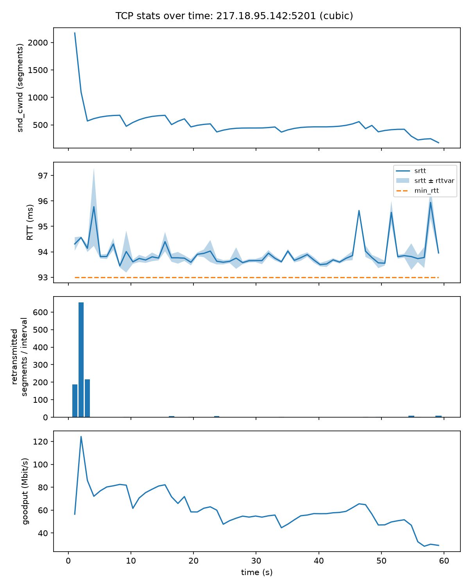

*Figure 1: snd_cwnd, RTT, retransmitted segments, and goodput over time for 217.18.95.142:5201 (CUBIC).*

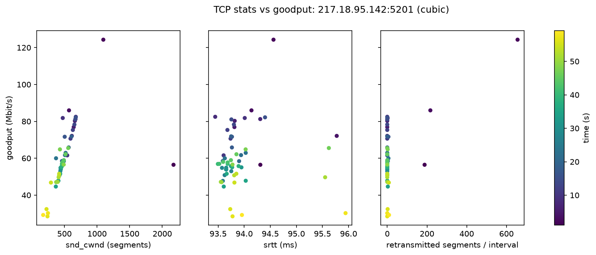

*Figure 2: snd_cwnd, srtt, and retransmitted segments vs goodput for 217.18.95.142:5201 (CUBIC), colored by time.*

### (c) Observations

| Metric | Meaning | Expected effect on goodput in congestion avoidance |
| --- | --- | --- |
| snd_cwnd | Max number of unacknowledged segments the sender can have in flight | Goodput ≈ cwnd × MSS / RTT until cwnd reaches the BDP. Past that, extra cwnd just fills the bottleneck queue. |
| srtt | Smoothed RTT estimate | For a fixed cwnd, higher RTT means lower goodput. srtt rising above min_rtt means packets are queueing. |
| Retransmitted segments | Our loss proxy | Each loss event makes CUBIC cut cwnd to 0.7×, so goodput should drop after retransmissions. |
| Goodput | Bytes acknowledged per second | The result the other metrics explain. |

On this path goodput was mostly determined by cwnd. After slow start, goodput tracked cwnd closely (r = 0.94), and in Figure 2 the cwnd-vs-goodput panel is close to a straight line. For example, at 8.2 s, 674 segments × 1448 B × 8 / 93.4 ms = 83.6 Mbit/s, compared to a measured 82.5 Mbit/s. srtt stayed between 93.4 and 96.0 ms against a 93.0 ms minimum, so there was almost no queueing and srtt had no real relationship with goodput (r = −0.02).

The loss events behaved like CUBIC should. After each loss, ssthresh dropped to about 0.7× the previous cwnd (e.g. 674→471, 518→364, 419→293), and cwnd then grew back in the concave CUBIC shape, flattening out near the old maximum between 27 and 43 s. The retransmission count by itself didn't predict goodput well (r = −0.24), since most intervals had zero retransmissions and each loss event only retransmitted 2–9 segments, but each one still cost 30% of cwnd. There were no timeouts in any of the 10 traces (`rto_backoffs` was always 0).

Anomalies:

- **Slow-start overshoot.** cwnd hit 2172 segments at t = 1 s, and 96% of the run's retransmissions happened in the first 3 s before cwnd fell to 570.
- **Downward drift.** Goodput fell from about 82 to 29 Mbit/s over the minute while ssthresh dropped from 555 to 174 segments, with no increase in RTT. Losses kept arriving before cwnd got back to its previous max, so CUBIC kept lowering its target. Since RTT stayed flat, these losses were probably from a shallow buffer, a policer, or cross traffic rather than our own queue, but the trace can't tell us which.
- **RTT spikes while cwnd was falling.** srtt jumped to around 96 ms at 46, 51, and 58 s while our cwnd was shrinking, which suggests other traffic at the bottleneck.
- **Other paths.** On 185.246.208.67:5201, srtt reached 308.6 ms against a 122.0 ms minimum. On 156.146.40.65:5201 the mean goodput (17.7 Mbit/s) was almost 4× the median (4.6 Mbit/s), so a few fast seconds carried most of the data.

## Part 3: Algorithm comparison and design

3a.) We noticed that cubic had more consistency with reno regarding RTT, however reno demonstrated faster RTTs + more consistent goodput. BBRs output seemed to be more "random", lacking patterns with goodput and RTT.

The plots below come from session `20261020T191606` ([`results/run_metadata.json`](../results/run_metadata.json)): 60 s tests at 1 s sampling, with CUBIC, Reno, and BBR each run against the same destinations. The TCP stats plots use the same representative destination, 194.24.162.86:4000, for all three algorithms.

#### Goodput over time

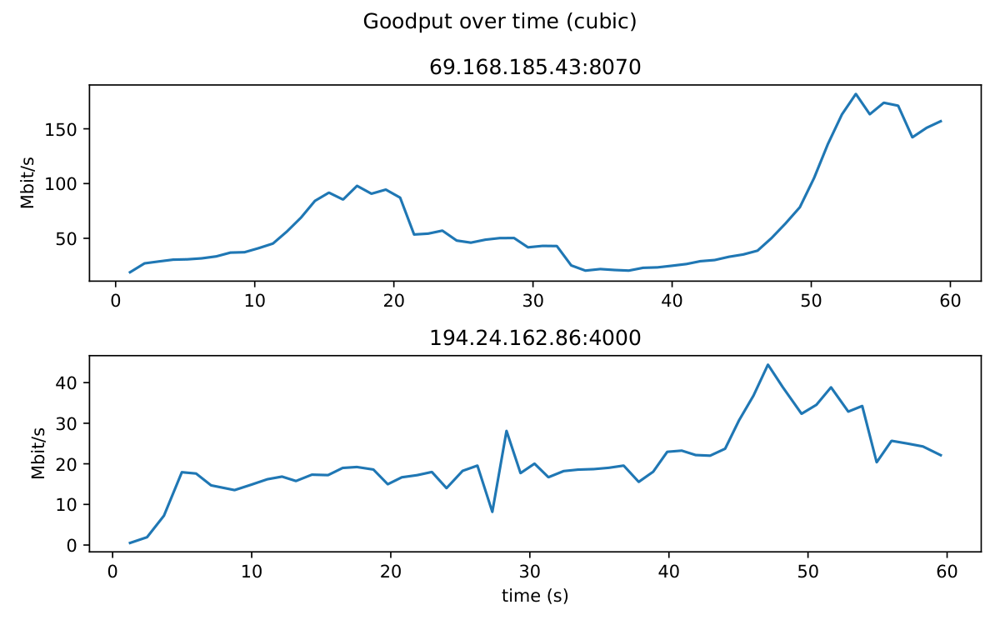

*Figure 3a: Goodput over time per destination (CUBIC). Source: [`results/goodput_cubic.pdf`](../results/goodput_cubic.pdf).*

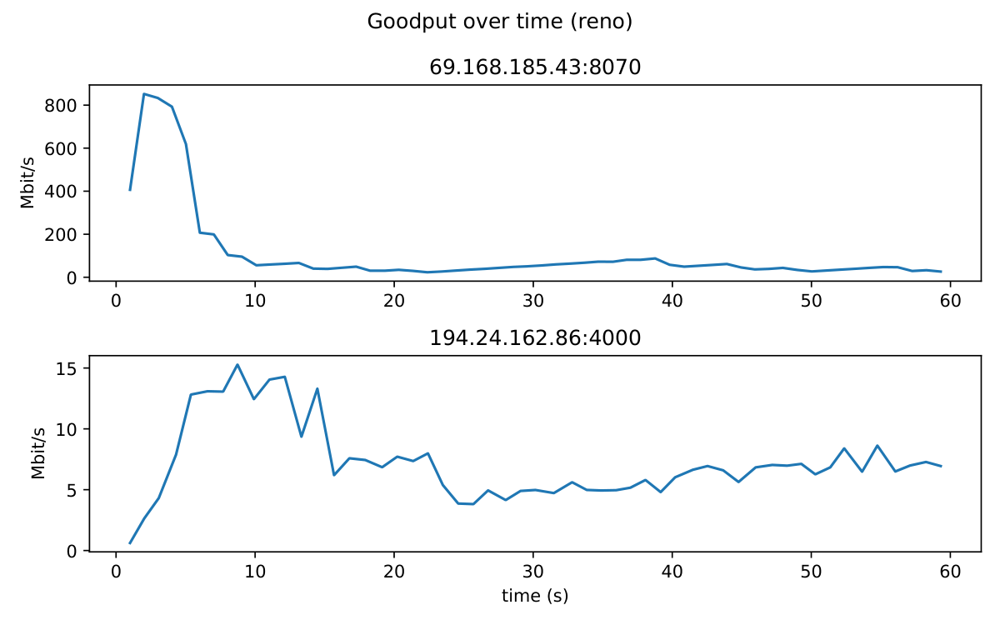

*Figure 3b: Goodput over time per destination (Reno). Source: [`results/goodput_reno.pdf`](../results/goodput_reno.pdf).*

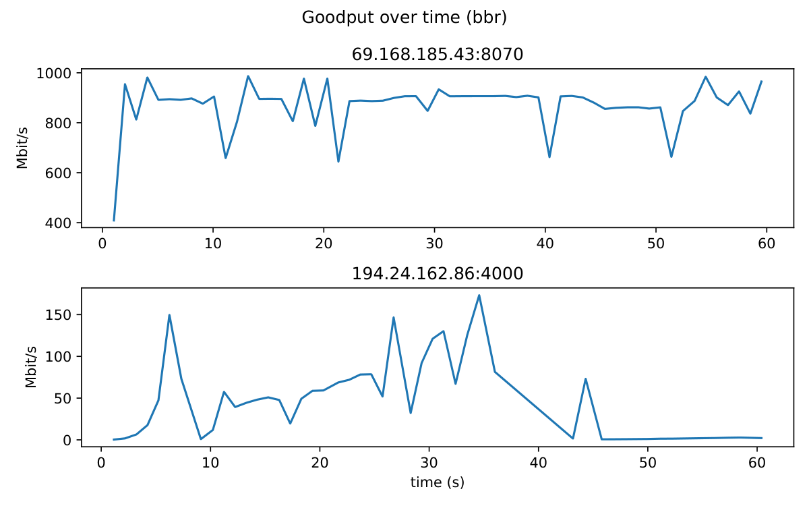

*Figure 3c: Goodput over time per destination (BBR). Source: [`results/goodput_bbr.pdf`](../results/goodput_bbr.pdf).*

#### TCP stats over time (194.24.162.86:4000)

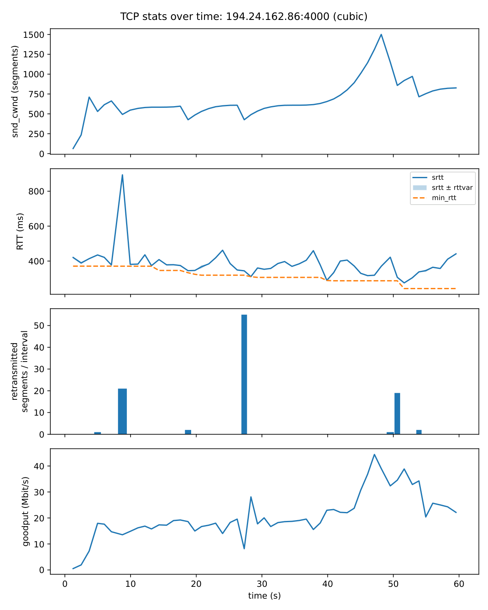

*Figure 4a: snd_cwnd, RTT, retransmitted segments, and goodput over time (CUBIC). Source: [`results/tcp_stats_timeseries_cubic.pdf`](../results/tcp_stats_timeseries_cubic.pdf).*

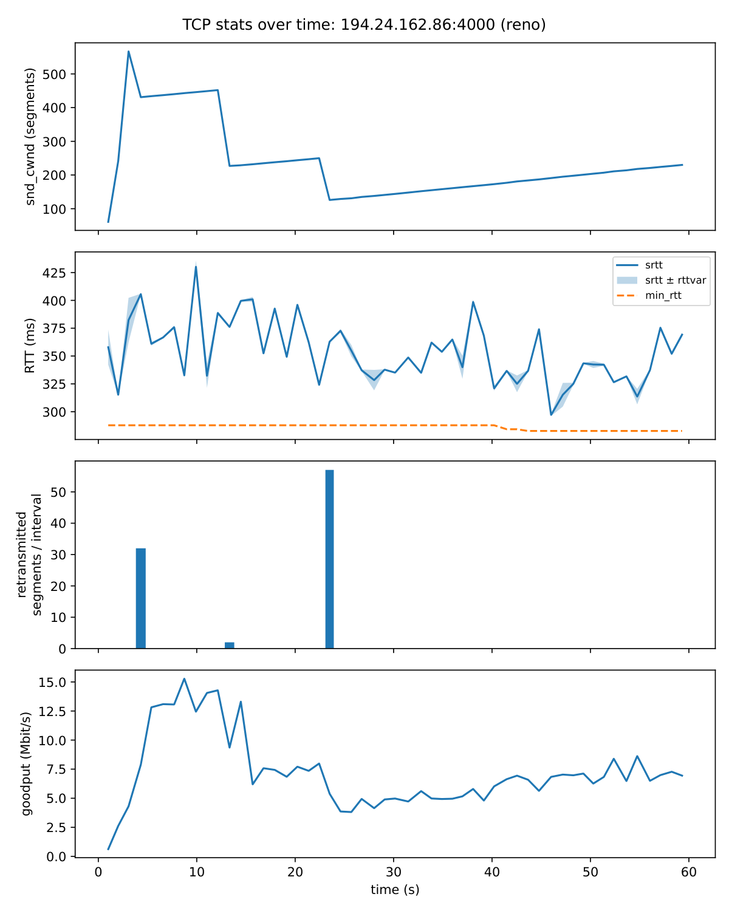

*Figure 4b: snd_cwnd, RTT, retransmitted segments, and goodput over time (Reno). Source: [`results/tcp_stats_timeseries_reno.pdf`](../results/tcp_stats_timeseries_reno.pdf).*

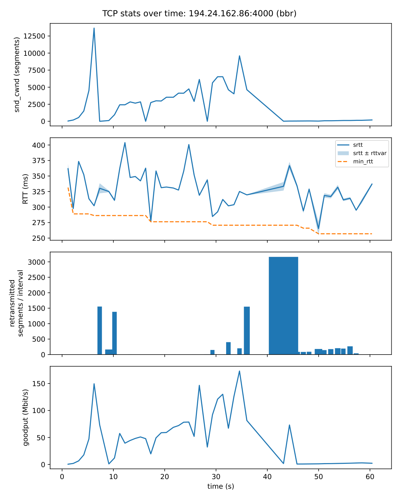

*Figure 4c: snd_cwnd, RTT, retransmitted segments, and goodput over time (BBR). Source: [`results/tcp_stats_timeseries_bbr.pdf`](../results/tcp_stats_timeseries_bbr.pdf).*

#### TCP stats vs goodput (194.24.162.86:4000)

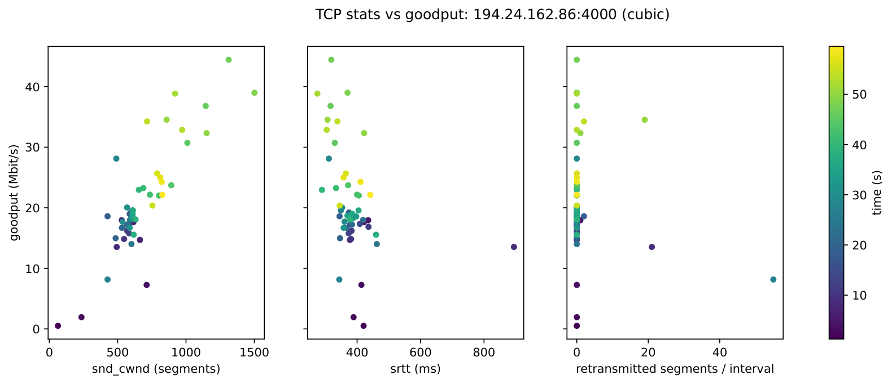

*Figure 5a: snd_cwnd, srtt, and retransmitted segments vs goodput, colored by time (CUBIC). Source: [`results/tcp_stats_scatter_cubic.pdf`](../results/tcp_stats_scatter_cubic.pdf).*

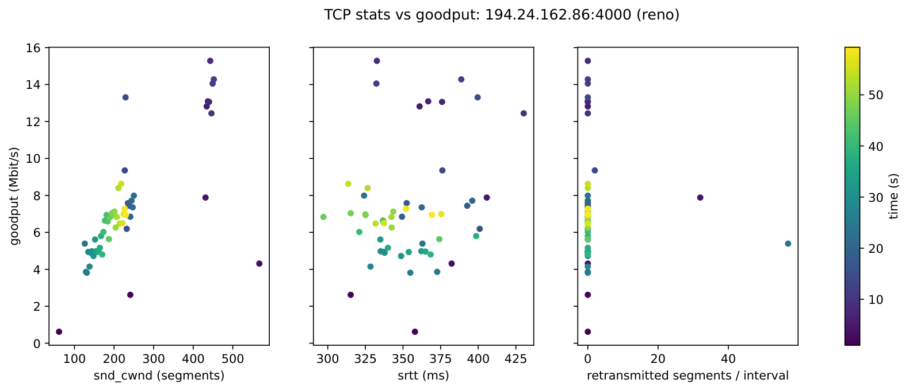

*Figure 5b: snd_cwnd, srtt, and retransmitted segments vs goodput, colored by time (Reno). Source: [`results/tcp_stats_scatter_reno.pdf`](../results/tcp_stats_scatter_reno.pdf).*

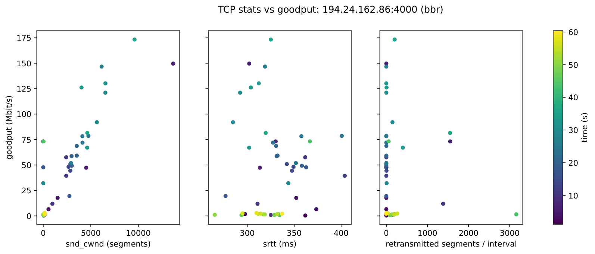

*Figure 5c: snd_cwnd, srtt, and retransmitted segments vs goodput, colored by time (BBR). Source: [`results/tcp_stats_scatter_bbr.pdf`](../results/tcp_stats_scatter_bbr.pdf).*

3b.)

```
Start up with the minimum window size

ONCE EVERY ROUND TRIP
  1. Measure:
     - base delay    = fastest round trip seen recently
     - current delay = smoothed round trip time
     - extra delay   = how far current delay is above base delay
     - goodput       = how much data got through this round trip

  2. If the connection timed out:
       Shrink window to minimum, go back to start-up mode.

  3. Else if packets were lost:
       If extra delay is large → shrink window to 60% (a real queue built up)
       If extra delay is small → shrink window to 90% (probably random loss)
       Leave start-up mode.

  4. Else if in start-up mode:
       If extra delay is getting noticeable → leave start-up mode
       Otherwise → double the window

  5. Else (normal operation):
       If extra delay is below target:
           Grow the window by a few packets.
           Grow more when far below target, less when close to it.
           If the last increase didn't raise goodput → grow only slightly.
       If extra delay is above target:
           Shrink the window by a percentage.
           Shrink more the further above target it is (never more than half).

  6. Never let the window be smaller than the minimum window size
     or bigger than about twice what the path can hold.
```

## AI use

Generated code and assisted with report + analysis using Codex and Claude Code.
